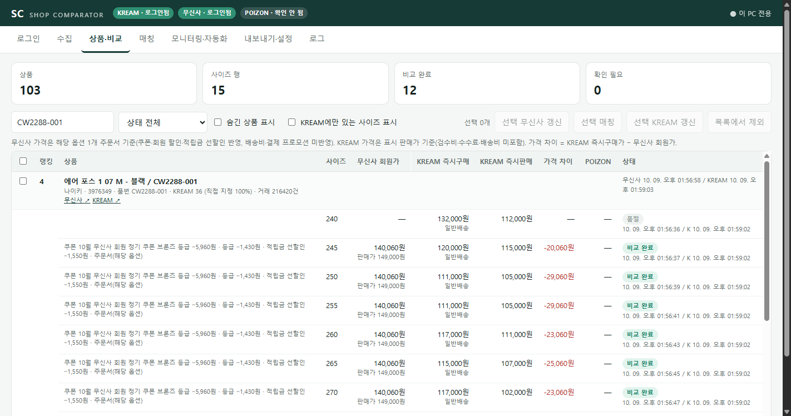
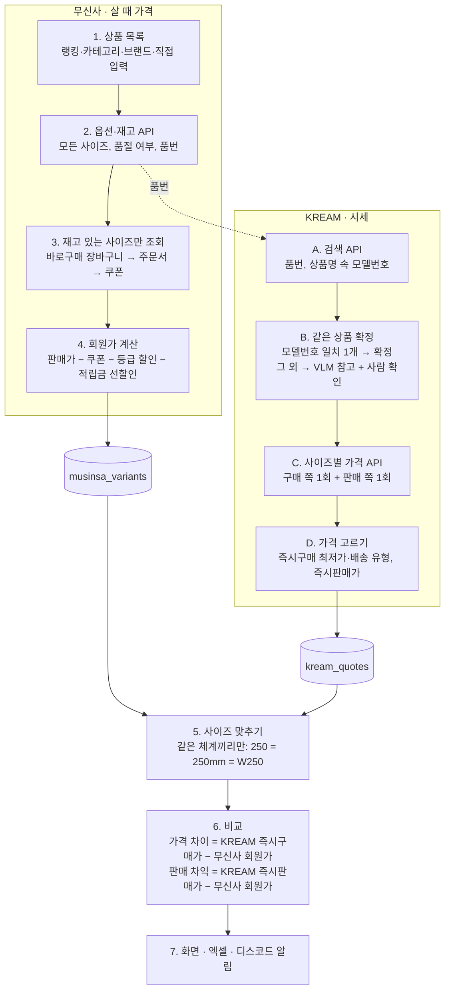
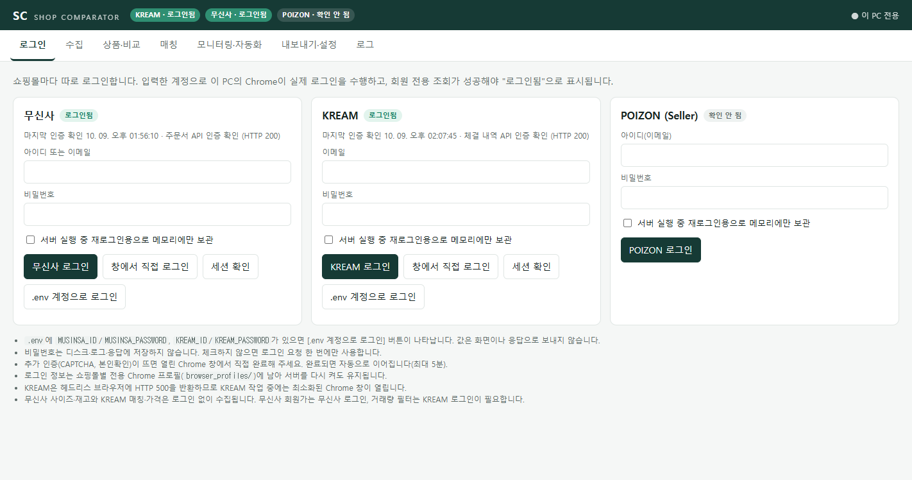
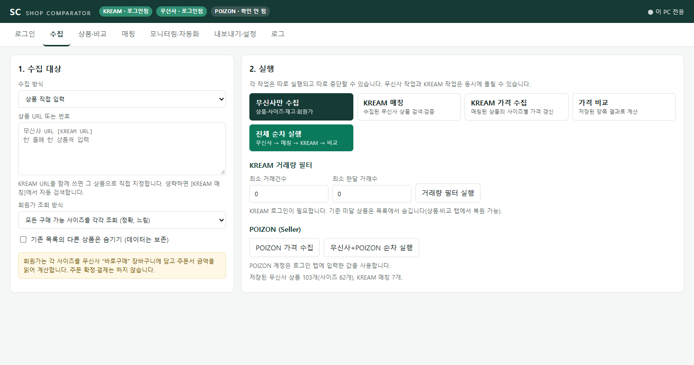
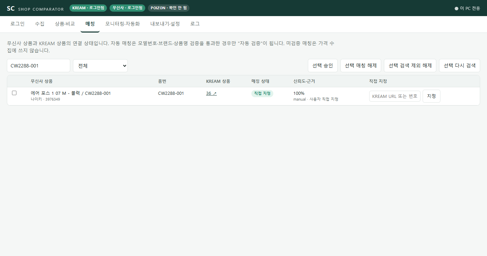
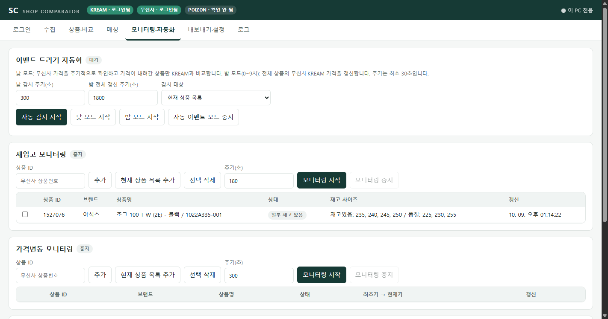
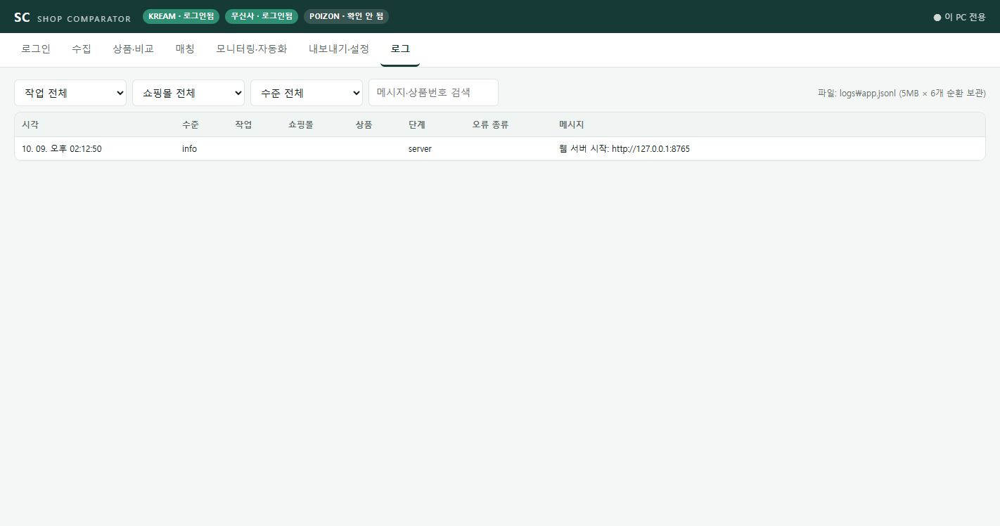

# Shop Comparator — 무신사 × KREAM 사이즈별 가격 비교 시스템

무신사에서 **로그인 회원이 실제로 살 수 있는 가격**(쿠폰·등급 할인·적립금 선할인 반영)과 KREAM의 **사이즈별 시세**(즉시구매가·즉시판매가)를 수집하고, 두 쇼핑몰의 같은 상품을 **모델번호와 이미지로 매칭**한 뒤 같은 사이즈끼리 비교해 화면·엑셀·디스코드 알림으로 내보내는 로컬 웹 애플리케이션이다.

원래는 4,600줄짜리 Tkinter 데스크톱 프로그램 한 파일이었다. 이 저장소는 그 프로그램을 웹으로 옮기면서 수집 방식, 상품 매칭, 코드 구조를 다시 설계하고 실제 사이트와 고정 데이터로 검증한 결과물이다.



## 목차

1. [한눈에 보기](#1-한눈에-보기)
2. [실제 실행 결과](#2-실제-실행-결과)
3. [핵심 문제 해결: 상품 매칭](#3-핵심-문제-해결-상품-매칭)
4. [기존 프로그램 대비 달라진 점](#4-기존-프로그램-대비-달라진-점)
5. [시스템 구조](#5-시스템-구조)
6. [기능 상세](#6-기능-상세)
7. [핵심 설계 결정](#7-핵심-설계-결정)
8. [문제 해결 기록](#8-문제-해결-기록)
9. [테스트](#9-테스트)
10. [설치와 실행](#10-설치와-실행)
11. [환경 변수](#11-환경-변수)
12. [검증 범위와 한계](#12-검증-범위와-한계)
13. [상세 문서](#13-상세-문서)

---

## 1. 한눈에 보기

| 항목 | 내용 |
|---|---|
| 목적 | 무신사 회원가와 KREAM 시세를 같은 상품·같은 사이즈 단위로 비교 |
| 형태 | 로컬 단일 사용자 웹 앱 (Flask, `http://127.0.0.1:8765`) |
| 언어·도구 | Python 3.12, Flask, SQLite, Selenium(Chrome), Playwright, pandas, openpyxl, Pillow, OpenAI Responses API, Ollama(선택) |
| 프런트엔드 | 프레임워크 없는 HTML/CSS/JavaScript, 탭 7개, CSP `default-src 'self'` |
| 수집 방식 | 쇼핑몰이 자기 화면에서 쓰는 JSON API를 쇼핑몰 페이지가 열린 Chrome 안에서 호출 |
| 상품 매칭 | 모델번호 대조 → 이미지 판정(VLM) → 사람이 엑셀로 확인 |
| 저장 | SQLite. 새로고침·서버 재시작 후에도 결과 유지 |
| 코드 구조 | `shop_comparator/` 패키지 7개 (web, services, matching, shops, storage, core, desktop) |
| 테스트 | 모의 데이터 테스트 103개 (쇼핑몰 접속 없음), GitHub Actions에서 실행 |

### 주요 기능

- 쇼핑몰별 로그인(계정 입력 / `.env` 계정 / 창에서 직접 로그인)과 인증 상태 검증
- 무신사 수집: 랭킹 3종, 카테고리 13종, 브랜드, 상품 직접 입력
- 사이즈별 회원가 계산(재고 있는 사이즈만, 주문·결제 없음)
- KREAM 검색, 모델번호 대조 매칭, 이미지 저장, VLM 판정(OpenAI / 로컬 모델)
- KREAM 사이즈별 즉시구매가·즉시판매가, 최근 체결 건수
- 사이즈 정규화와 비교, 조건 필터 엑셀(이미지 포함)
- 재입고·가격변동·구매제한 모니터링, 이벤트 자동화, 디스코드 알림
- 작업별 실행·중단·진행률, 구조화 로그, 작업 이력
- 매칭 성능 평가 스크립트와 고정 데이터

---

## 2. 실제 실행 결과

2026-10-09에 무신사 신발 랭킹 상위 200개로 전체 과정을 실제 사이트에서 실행한 결과다.

| 단계 | 결과 |
|---|---|
| 무신사 상품·사이즈·재고·회원가 수집 | 200개 중 200개 성공 |
| KREAM 검색 후보 확보 | 200개 (썸네일 이미지 로컬 저장) |
| 상품 매칭 | 130개 (모델번호 일치 125, 기존 자동 판별기 3, 이미지 검토 2) |
| KREAM 사이즈별 가격 | 130개 중 130개 성공 (4개는 자동 재시도로 복구) |
| 사이즈 단위 비교 완료 | 114개 상품, 1,155개 사이즈 |
| 최근 30일 체결 10건 이상 | 85개 상품 |
| 조건 충족(체결 10건 이상 + KREAM 즉시구매가가 1만원 이상 높음) | 21개 상품, 67개 사이즈 |

### 가격 계산 예 (나이키 에어포스 1 '07 블랙, 무신사 3976349 ↔ KREAM 36)

```
무신사 회원가 140,060 = 판매가 149,000 − 쿠폰 5,960 − 등급 할인 1,430 − 적립금 선할인 1,550
```

| 사이즈 | 무신사 회원가 | KREAM 즉시구매 | KREAM 즉시판매 | 차이(KREAM 즉시구매 − 무신사) |
|---|---|---|---|---|
| 250 | 140,060 | 111,000 (일반배송) | 105,000 | −29,060 |
| 270 | 140,060 | 117,000 (일반배송) | 102,000 | −23,060 |
| 295 | 140,060 | 121,000 (일반배송) | 116,000 | −19,060 |

> 수치는 실행 시점의 값이다.

---

## 3. 핵심 문제 해결: 상품 매칭

이 프로젝트에서 가장 영향이 컸던 문제다. 상세 기록은 [docs/matching-evaluation.md](docs/matching-evaluation.md)에 있다.

### 3.1 문제

기존 프로그램은 무신사 상품을 KREAM에서 찾을 때 이렇게 했다.

1. 무신사 품번으로 KREAM을 검색해, 검색 결과 중 **품번이 같은 상품**을 고른다.
2. 없으면 **검색 결과의 첫 번째 상품**을 고른다.

그런데 **같은 상품이어도 두 쇼핑몰의 품번이 다른 경우**가 많았다.

| 원인 | 실제 예 |
|---|---|
| 무신사 품번이 판매자의 자체 관리번호 | 무신사 `NBPDGF733B_19` ↔ KREAM `U740BM2`. 실제 모델번호는 무신사 상품명 "NBPDGF733B / **U740BM2** (BLACK)" 안에 있다 |
| 표기 차이 | 무신사 `VN000D3HBKA1` ↔ KREAM `VN000D3HBKA` |
| 품번이 같아도 다른 상품 | 에어포스 1 화이트 `CW2288-111`은 일반판과 트래비스 스캇 협업판이 같은 모델번호를 쓴다. 기존 프로그램이 저장해 둔 매칭은 협업판이었다 |
| 품번이 안 맞으면 첫 번째 결과 사용 | KREAM에 없는 상품을 검색하면 이름이 비슷한 다른 브랜드 상품이 첫 번째로 나온다 |

다른 상품의 시세와 비교한 가격 차이는 의미가 없으므로, 매칭 정확도가 결과 전체의 신뢰도를 결정했다.

### 3.2 시도한 방법

| 단계 | 방법 | 비용 |
|---|---|---|
| A | **모델번호 대조 확장.** KREAM 상품 페이지의 모델번호를 읽고, 무신사 품번과 **상품명 속 모델번호**를 모두 대조한다. 기호를 빼고 비교하며 3자 이내 접미 차이를 허용한다. 일치하는 후보가 **정확히 하나일 때만** 확정한다 | 0원 |
| B | **이미지 판정(VLM).** A로 확정하지 못한 상품은 무신사 썸네일과 KREAM 후보 썸네일을 비전 모델에 보내 `same / different / uncertain`, 고른 후보, 신뢰도, 사유를 JSON 스키마로 받는다 | 모델별 |
| C | **사람 확인.** VLM의 "동일"은 자동 등록하지 않고, 이미지를 나란히 넣은 엑셀로 확인한 뒤 등록한다 | |

B 단계의 모델

| 모델 | 실행 위치 | 사용 범위 |
|---|---|---|
| `gpt-5.4-nano` | OpenAI API | 10개 표본 (비용·정확도 측정) |
| `gpt-5.4-mini` | OpenAI API | 246개 전체 |
| `Qwen3-VL-8B` | 자체 GPU PC (RTX 4090, LM Studio), SSH 터널 | 이미지 쌍 100개 벤치마크 |

세 모델의 비교는 [3.4 VLM 벤치마크](#34-vlm-벤치마크)에 있다.

### 3.3 결과 (무신사 신발 랭킹 246개 상품)

기존 규칙을 저장된 검색 결과에 그대로 적용한 것과 비교했다.

| 방법 | 같은 상품을 찾은 수 | 비율 |
|---|---|---|
| 기존 규칙 (품번이 같은 검색 결과) | 118 | 48.0% |
| A. 모델번호 대조 확장 | 153 | 62.2% |
| A + B + C (VLM이 찾고 사람이 확인) | **167** | **67.9%** |

- 기존 규칙이 못 찾던 상품 **49개**를 더 찾았다(41.5% 증가). 35개는 모델번호 대조 확장으로, **14개는 VLM으로** 찾았다.
- 기존 규칙은 128개(52.0%)에서 첫 번째 결과를 그대로 썼다. 그중 확인한 52개의 **84.6%(44개)가 다른 상품**이었다. 현재 방식은 확정하지 못하면 매칭하지 않는다.

VLM(`gpt-5.4-mini`) 자체의 정확도

| 항목 | 결과 |
|---|---|
| 모델번호로 확정된 153개에서 같은 후보를 고름 | 148 (96.7%) |
| 모델번호로 확정하지 못한 93개 | 동일 23, 다름 66, 불확실 4 |
| "동일" 23개를 사람이 확인 | 맞음 14, 틀림 6, 판단 보류 3 |
| 상품당 응답 시간, 비용 | 2.8초, 약 2.7원 |

`gpt-5.4-nano`는 10개 표본에서 정답과 6개 일치(mini는 8개), 상품당 약 0.8원이었다. 두 모델 모두 색상만 다른 상품 1건을 "동일"로 판정했고(mini 신뢰도 0.94), 모델번호 대조가 이를 걸러냈다.

### 3.4 VLM 벤치마크

로컬 모델과 API 모델 중 무엇을 쓸지 정하려고, 세 모델에 **같은 이미지 쌍 100개**(동일 50, 다름 50)를 주고 "두 이미지가 같은 상품인가"만 물었다. 상품명과 모델번호는 주지 않았다.

| 항목 | Qwen3-VL-8B (로컬) | gpt-5.4-mini | gpt-5.4-nano |
|---|---|---|---|
| 실행 위치 | 자체 GPU PC(RTX 4090, LM Studio), SSH 터널 | OpenAI API | OpenAI API |
| 정확도 (100쌍) | **92.0%** | 87.0% | 73.0% |
| "동일" 판정 정밀도 | 90.4% (47/52) | 95.6% (43/45) | **100%** (26/26) |
| "동일" 재현율 | **94.0%** (47/50) | 86.0% (43/50) | 52.0% (26/50) |
| 다른 상품을 "동일"로 판정 | 10.0% (5/50) | 4.0% (2/50) | **0%** (0/50) |
| "불확실" 응답 | 0 | 8 | 18 |
| 응답 시간 (중앙값) | 4.0초 (터널 포함, 추론은 2~3초) | 2.6초 | 2.5초 |
| API 비용 (쌍당) | 0원 (전기·장비는 별도) | 약 1.78원 | 약 0.52원 |
| 1만 쌍 기준 API 비용 | 0원 | 약 17,800원 | 약 5,200원 |
| 이미지 외부 전송 | 없음 (자체 서버) | 있음 | 있음 |

| 모델 | 장점 | 단점 | 맞는 용도 |
|---|---|---|---|
| Qwen3-VL-8B (로컬) | 정확도와 재현율이 가장 높다. 호출당 비용이 없다. 이미지가 외부 API로 나가지 않는다. 색상만 다른 상품을 "같은 모델의 다른 변형"으로 따로 답한다(9건) | 다른 상품을 "동일"로 가장 많이 판정했다(5건). 신뢰도가 맞은 판정과 틀린 판정에서 같아(0.95~0.98) 걸러낼 수 없다. "불확실"을 쓰지 않는다. GPU PC가 켜져 있어야 하고 한 번에 한 건만 처리한다 | 후보를 넓게 찾는 1차 선별. 대량 처리 |
| gpt-5.4-mini | 정밀도와 재현율의 균형이 좋다. 애매한 쌍 8건을 "불확실"로 답해 사람에게 넘긴다. 설치가 필요 없다 | 호출마다 비용이 든다. 틀린 "동일" 2건의 신뢰도(0.84~0.86)가 맞은 판정 범위 안에 있다 | 사람이 확인하기 전 최종 후보 제안 |
| gpt-5.4-nano | 다른 상품을 "동일"로 판정한 적이 없다. 가장 싸다 | 같은 상품의 절반을 놓친다(재현율 52%). 18건을 "불확실"로 답한다 | "동일"만 믿고 쓰는 보수적 필터. 찾는 용도로는 부족 |

- 쉬운 쌍(모델번호가 다른 상품 44개)은 세 모델 모두 42~43개를 맞혔다. 차이는 "얼마나 과감하게 동일이라고 답하는가"에서 났다.
- 사람이 틀렸다고 확인한 어려운 6쌍에서 Qwen은 4건을 다시 "동일"(신뢰도 0.95~0.98)이라고 했고, mini는 4건을 "불확실"로 넘겼다.
- 어느 모델도 신뢰도 값으로 맞은 판정과 틀린 판정을 가를 수 없었다. 그래서 VLM 결과는 자동 등록하지 않는다.
- Qwen은 서버가 정한 프롬프트의 비교 API만 제공해 프롬프트가 OpenAI 쪽과 같지 않다. 100쌍 규모라 1~2건 차이는 의미가 없다. 쌍 목록과 모델별 판정은 `docs/evaluation/`에 있다.

```powershell
.\.venv\Scripts\python.exe -m shop_comparator.matching.vlm_benchmark
```

### 3.5 결론

- 품번이 달라 못 찾던 문제는 **부분적으로 해결**됐다. 찾은 상품이 118개에서 167개로 늘었고, 틀린 매칭을 만들던 "첫 번째 결과" 규칙을 없앴다.
- **VLM만으로는 부족하다.** 모델번호가 있는 상품은 97% 맞히지만, 모델번호가 없는 상품에서는 "동일" 판정의 30%가 틀렸고 신뢰도 값으로 걸러지지 않았다. 벤치마크에서도 틀린 "동일"이 없는 모델(nano)은 같은 상품의 절반을 놓쳤다. 그래서 모델번호 → VLM → 사람 순서를 쓴다.
- **모델 선택은 용도에 따른다.** 넓게 찾을 때는 로컬 Qwen3-VL-8B(재현율 94%, API 비용 0), 사람에게 넘길 후보를 고를 때는 gpt-5.4-mini(정밀도 95.6%)가 맞았다.
- 평가는 저장소의 고정 데이터로 다시 실행할 수 있다.

```powershell
.\.venv\Scripts\python.exe -m shop_comparator.matching.evaluate
```

> 정답 라벨은 작성자가 이미지·상품명·모델번호로 판정했다. VLM이 "다름"이라고 한 66개는 전부 확인하지 않았으므로 놓친 동일 상품 수는 측정하지 못했다.

---

## 4. 기존 프로그램 대비 달라진 점

| 항목 | 기존 (Tkinter GUI) | 현재 |
|---|---|---|
| 코드 구조 | `gui.py` 한 파일 4,636줄 + 루트에 평면 모듈 30여 개. 화면, 수집, 계산, 저장이 한 클래스에 섞여 있음 | `shop_comparator/` 아래 역할별 패키지 7개. 화면(web) / 수집 흐름(services) / 매칭(matching) / 쇼핑몰 접근(shops) / 저장(storage) / 공통(core) |
| 화면 | 데스크톱 창 | 브라우저 탭 7개, 수집 중 실시간 갱신 |
| 수집 방식 | `requests`·`curl`로 직접 호출. 현재 두 쇼핑몰 모두 거절(403, 500) | 쇼핑몰 페이지가 열린 Chrome 안에서 API 호출 |
| 무신사 가격 | 상품당 첫 번째 구매 가능 옵션 1개의 회원가를 모든 사이즈에 표시 | 재고 있는 사이즈별로 저장. 옵션 추가금이 다르면 따로 조회 |
| 상품 매칭 | 품번이 같은 검색 결과, 없으면 첫 번째 결과 | 모델번호 대조 → VLM → 사람 확인 (3장) |
| 사이즈 매칭 | 숫자만 추출해 비교 (`US 8`과 `UK 8`이 같아질 수 있음) | 같은 사이즈 체계끼리만 매칭 |
| 저장 | 수집을 시작할 때 상품 테이블을 비우고 다시 채움 | 기존 행을 유지하고 수집된 상품만 갱신 |
| 실패 처리 | 실패한 쪽 때문에 전체 결과가 비거나, 실패가 품절처럼 보임 | 실패는 사유와 함께 기록하고 이전 값·다른 쇼핑몰 값은 유지 |
| 작업 제어 | 버튼 하나가 전체 과정을 실행 | 단계별 작업, 쇼핑몰별 동시 실행, 작업별 중단, 진행률, 이력 |
| 로그 | `print`와 텍스트 창 | JSON Lines 파일(회전), 작업 ID·쇼핑몰·상품번호 필터, 민감정보 마스킹 |
| 입찰가 계산 | 부동소수점 (90,000 × 1.1 → 100,000) | Decimal (99,000) |
| 테스트 | 14개 | 103개 + CI |
| 문서 | 없음 | 설계·검증·문제 해결·평가 문서 12개 |

기존 GUI는 `shop_comparator/desktop/`에 내용을 그대로 두었고 `python main.py --desktop`으로 실행된다.

### 리팩토링에서 한 일

- 루트의 평면 모듈 37개를 패키지(34개)와 `scripts/`(3개)로 옮기고 import 172곳을 AST로 일괄 변환했다.
- `gui.py`에 섞여 있던 수집 흐름을 `services/pipeline.py`의 단계 함수로 분리하고, 계산(`comparison_service.py`)을 네트워크 코드와 떼어 단위 테스트할 수 있게 했다.
- 기존 `crawler.py`의 상품 단위 함수에서 옵션 단위 함수(`price_option`)를 분리해 "다른 옵션의 가격으로 대체"가 불가능하게 했다.
- 쇼핑몰 접근을 `BrowserSession` 어댑터 하나로 모아, 기존 코드가 쓰던 `requests` 인터페이스를 유지하면서 전송 방식만 바꿨다.
- 옮기면서 조용히 깨지는 경로 의존 2곳(`.env` 위치, 보조 스크립트 호출)을 찾아 고쳤다.

---

## 5. 시스템 구조

### 5.1 가격이 추출되고 비교되는 흐름



두 쇼핑몰의 결과는 따로 저장하고 비교는 요청할 때마다 계산한다. 그래서 한쪽 수집이 실패해도 다른 쪽 값과 이전 값이 남는다.

### 5.2 디렉터리

```text
main.py                        실행 진입점 (웹 기본, --desktop 은 기존 GUI)
shop_comparator/
├─ web/
│  ├─ web_app.py               Flask API, 입력 검증, 다운로드, 로컬 전용 접근 제어
│  ├─ templates/, static/      화면 (HTML, CSS, JavaScript)
├─ services/
│  ├─ pipeline.py              수집 단계: 무신사 / 매칭 / KREAM 가격 / 비교 / 거래량 필터 / POIZON / 전체
│  ├─ jobs.py                  작업 관리: 작업 ID, 상태, 진행률, 중단, 쇼핑몰별 배타 실행
│  ├─ comparison_service.py    사이즈 정규화, 매칭 상태 해석, 비교 행 계산 (네트워크 없음)
│  ├─ monitoring.py            재입고·가격변동·구매제한 모니터링, 이벤트 자동화
│  └─ exports.py               비교 엑셀/CSV, GUI 형식 CSV, KREAM 입찰 엑셀
├─ matching/
│  ├─ match_review.py          후보·이미지·모델번호 수집, 모델번호 대조, 확인용 엑셀 (CLI)
│  ├─ vlm_match.py             이미지 판정: OpenAI / 로컬 Ollama 백엔드 (CLI)
│  ├─ evaluate.py              기존 규칙 대비 성능 평가 (CLI)
│  ├─ vlm_benchmark.py         VLM 모델 비교: 이미지 쌍 구성, 실행, 채점 (CLI)
│  └─ product_matcher.py       기존 자동 판별기 (규칙 + OpenAI)
├─ shops/
│  ├─ browser_transport.py     쇼핑몰 Chrome 페이지 안에서 API를 호출하는 requests 호환 어댑터
│  ├─ site_login.py            쇼핑몰별 로그인, 인증 확인, 메모리 계정 보관
│  ├─ crawler.py               무신사 API 호출, 회원가 계산식
│  ├─ kream_crawler.py         KREAM 검색, 응답 파싱
│  ├─ kream_api.py             KREAM 사이즈별 시세·체결 내역 파싱
│  └─ poizon_seller_crawler.py POIZON 셀러 센터
├─ storage/
│  ├─ database.py              기존 SQLite 스키마, 매칭 캐시
│  └─ store.py                 웹용 테이블(추가만 함): 사이즈별 가격, 시세, 설정, 작업 이력
├─ core/
│  ├─ app_logging.py           중앙 로그: JSON Lines 회전 파일, 화면용 버퍼, 민감정보 마스킹
│  ├─ crawl_errors.py          오류 종류 정의
│  └─ config.py, utils.py, webhook.py
└─ desktop/                    기존 Tkinter 프로그램 (gui.py 등)
tests/                         모의 데이터 테스트 103개
docs/                          설계·검증·문제 해결 문서
docs/evaluation/               매칭 평가 데이터, 확인 라벨, VLM 벤치마크 쌍과 판정
scripts/                       보조 스크립트
.github/workflows/tests.yml    CI
```

`core`는 다른 패키지를 import하지 않고 `storage`는 `core`만 import한다. `web`은 진입점이라 다른 패키지에서 import하지 않는다.

### 5.3 작업(Job) 모델

모든 수집과 로그인은 작업으로 실행된다.

| 항목 | 동작 |
|---|---|
| 작업 ID | 10자리. 그 작업이 남기는 모든 로그에 붙는다 |
| 배타 실행 | 작업마다 쓰는 쇼핑몰을 선언한다. 같은 쇼핑몰 작업은 하나만, 다른 쇼핑몰 작업은 동시에 실행된다 |
| 중단 | 작업마다 중단 버튼이 있다. 진행 중인 요청 하나가 끝나면 멈추고 저장된 결과는 남는다 |
| 상태 | 실행 중 → 완료 / 일부 실패 / 실패 / 중단됨. 서버가 꺼져 끝나지 못한 작업은 다음 시작 때 "서버 종료로 중단"으로 정리한다 |
| 이력 | `job_runs` 테이블에 요약과 오류 종류를 남긴다 |

### 5.4 저장소

기존 GUI 테이블은 그대로 두고, 웹은 테이블을 추가만 한다(`CREATE TABLE IF NOT EXISTS`, upsert).

| 테이블 | 내용 |
|---|---|
| `products` (기존) | 상품 1행. GUI와 공유. 웹은 전체 삭제 후 삽입을 하지 않는다 |
| `kream_search_cache` (기존) | 무신사↔KREAM 매칭, 방식(`model_code`·`image_review`·`manual`·자동), 신뢰도, 근거 |
| `musinsa_variants` | 사이즈별 재고, 판매가, 쿠폰, 회원가, 출처, 오류, 조회 시각 |
| `kream_quotes` | 사이즈별 즉시구매가, 배송 유형, 즉시판매가, 입찰 전용 여부, 후보 목록 |
| `web_product_state` | 목록 숨김 여부, 쇼핑몰별 마지막 수집 상태 |
| `job_runs`, `monitor_items`, `web_settings`, `site_sessions` | 작업 이력, 모니터링 대상, 설정, 로그인 상태(마스킹된 계정만) |

---

## 6. 기능 상세

### 6.1 로그인과 세션



- 무신사, KREAM, POIZON은 입력란·버튼·상태·실패 처리가 각각 독립이다. 한쪽 로그인 실패가 다른 쪽 상태를 바꾸지 않는다.
- 로그인 방법은 세 가지다.
  - 아이디·비밀번호 입력: 이 PC의 Chrome 창이 열려 자동 입력한다.
  - `.env` 계정: `MUSINSA_ID`/`MUSINSA_PASSWORD` 등이 있으면 버튼이 나타난다. 값은 응답에 넣지 않는다.
  - 창에서 직접 로그인: 창만 열고 사용자가 직접 로그인한다(네이버·Apple 로그인 등).
- CAPTCHA나 본인확인이 뜨면 그 창에서 사용자가 완료하고, 완료되면 같은 작업이 이어진다(최대 5분). 프로그램이 대신 풀지 않는다.
- **"로그인됨"은 회원 전용 API가 실제로 성공했을 때만** 표시한다. 주소 변경이나 쿠키 존재만으로 성공 처리하지 않는다.
  - 무신사: 주문서 API (비로그인 시 401)
  - KREAM: 체결 내역 API (비로그인 시 401). 시세·검색 API는 로그인 없이도 응답하므로 확인에 쓰지 않는다.
- 같은 확인을 로그인 직후, [세션 확인] 버튼, 회원가 수집·거래량 필터 시작 시에 수행한다. 만료면 요청을 멈추고 "다시 로그인 필요"로 표시한다.
- 비밀번호는 디스크·로그·응답·DB에 저장하지 않는다. 선택하면 서버 실행 중 메모리에만 보관해 만료 시 한 번 재로그인한다.

로그인이 필요한 범위

| 작업 | 로그인 |
|---|---|
| 무신사 사이즈·재고 | 불필요 |
| 무신사 회원가 | 무신사 |
| KREAM 검색·매칭·사이즈별 가격 | 불필요 |
| KREAM 체결 건수(거래량 필터) | KREAM |

### 6.2 무신사 수집



- 수집 대상: 상품 URL/번호 직접 입력(같은 줄에 KREAM URL을 쓰면 직접 매칭), 랭킹 3종(신발, 부티크 지갑/가방, 부티크 악세서리), 카테고리 13종 다중 선택, 브랜드 다중 선택, 현재 목록 전체 갱신.
- 상품마다 옵션 API와 재고 API를 조합해 **모든 사이즈와 품절 여부**를 저장한다. 사라진 옵션은 삭제하지 않고 표시만 내린다.
- 품번(모델번호)은 상품 페이지에서 추출한다.
- 회원가 조회 방식은 세 가지다.
  - 기본: 재고 있는 사이즈 중 옵션 추가금이 같으면 대표 1개만 조회(출처 열에 표시). 추가금이 다르면 따로 조회한다.
  - 재고 있는 사이즈를 각각 조회.
  - 사이즈·재고만 수집(로그인 불필요).
- 실패 처리
  - 인증(401)·차단(403)·한도(429)는 작업을 즉시 멈춘다. 자동 재시도나 우회는 없다.
  - 무신사가 주문을 받지 않는 상품(판매 종료 등)은 한 번만 확인하고 사유를 표시한 뒤 다음 상품으로 넘어간다.
  - 그 밖의 회원가 실패가 5회 연속이면 작업을 멈춘다.

### 6.3 무신사 회원가 계산

재고 있는 옵션을 "바로구매" 장바구니에 담고 주문서와 쿠폰 목록을 읽어 계산한다. **주문 확정·결제는 하지 않는다.**

```
쿠폰 적용가   = 옵션 판매가 − 최대 할인 쿠폰
등급 할인액   = 내림10(쿠폰 적용가 × 회원 등급 할인율)
적립금 선할인 = 상품 적립금 + 내림10((쿠폰 적용가 − 등급 할인액) × 등급 적립률)
회원가        = 쿠폰 적용가 − 등급 할인액 − 적립금 선할인
```

| 항목 | 포함 여부 |
|---|---|
| 최대 할인 쿠폰, 회원 등급 할인, 적립금 선할인 | 포함 |
| 배송비, 결제수단 프로모션, 구매 후 적립 | 미포함 |

지키는 규칙

- 주문서에서 상품번호와 옵션번호가 모두 일치하는 항목만 사용한다. 다른 옵션의 가격으로 대체하지 않는다.
- 조회 실패를 품절로 바꾸지 않는다. 실패한 사이즈는 가격을 비우고 사유를 남긴다.
- 실패 시 공개 가격을 회원가로 쓰지 않는다.
- 재조회가 실패하면 이전 검증값과 그 조회 시각을 유지하고 "갱신 실패(이전 값)"로 표시한다.

### 6.4 KREAM 가격

- 사이즈별 가격 API를 구매 쪽·판매 쪽으로 한 번씩 호출한다. 로그인이 필요 없다.
- **즉시구매 최저가**: 새 상품을 바로 살 수 있는 가격 중 배송 유형(일반·빠른·해외·브랜드배송)을 통틀어 가장 낮은 값. 어떤 배송 유형인지 함께 저장하고 후보 전체를 남긴다. 95점·보관판매 상품은 제외한다.
- **즉시판매가**: 가장 높은 구매 입찰가. 즉시구매가와 다른 열이다.
- 구매 입찰만 가능한 사이즈는 즉시구매가를 비우고 "즉시구매 불가(입찰만)"로 표시한다.
- 브랜드 배송 상품은 판매 쪽이 없고 옵션 키가 내부 번호라서, 화면에 표시되는 사이즈 이름으로 바꿔 저장한다.
- 검수비·수수료·배송비는 포함하지 않는다.
- 연결이 끊기면 5초 뒤 한 번 재시도하고, 3회 연속이면 작업을 멈춘다. 실패해도 이전 시세는 지우지 않는다.

### 6.5 상품 매칭 파이프라인



배경과 측정 결과는 [3장](#3-핵심-문제-해결-상품-매칭)에 있다. 여기서는 동작을 적는다.

**1단계. 후보 수집** (`match_review collect`)
- 무신사 품번과 상품명 속 모델번호로 KREAM을 검색한다.
- 상품당 후보의 썸네일과 무신사 썸네일을 512px JPG로 `match_review/images/<무신사 상품번호>/`에 저장한다.

**2단계. 모델번호 대조** (`match_review models`, `apply`)
- 후보의 KREAM 상품 페이지에서 모델번호를 읽는다.
- 기호를 뺀 뒤 완전히 같으면 "일치", 한쪽이 다른 쪽에 3자 이내 접미로 포함되면 "거의 일치". `BOLD`, `DAN`처럼 숫자가 없거나 짧은 코드는 근거로 쓰지 않는다.
- 일치하는 후보가 정확히 하나면 이미지 단계 없이 확정한다. 여러 개면 이미지로 넘긴다.

**3단계. 이미지 판정** (`vlm_match`, 선택)
- 저장된 이미지와 상품명·모델번호를 비전 모델에 보내 `same / different / uncertain`, 고른 후보, 신뢰도, 사유를 JSON 스키마로 받는다.
- 백엔드는 OpenAI Responses API(호출마다 토큰 사용량 기록)와 로컬 Ollama(`--local`)다. 벤치마크(`vlm_benchmark`)는 여기에 자체 호스팅 모델을 실행 파일로 연결하는 `remote` 백엔드를 더한다.
- 결과는 자동 등록하지 않는다.

**4단계. 사람이 확인** (`match_review export`)
- 상품 1행에 무신사·KREAM 이미지를 나란히 넣은 엑셀을 만든다. 상품ID, 상품명, 품번, 모델번호, 대조 결과, 매칭 방식·근거, VLM 판정, 양쪽 URL, O/X 기입 칸이 들어간다.
- 등록된 매칭과 VLM이 엇갈리는 행은 빨강, 일치는 초록, 미매칭 상품에 대한 VLM 제안은 노랑으로 표시한다.

매칭 상태

| 상태 | 뜻 | 가격 수집에 사용 |
|---|---|---|
| 모델번호 일치 | 무신사 품번과 KREAM 모델번호가 같은 후보가 하나뿐 | 예 |
| 이미지 검토 | 썸네일을 나란히 비교해 판정 | 예 |
| 직접 지정 | 사용자가 매칭 탭에서 KREAM URL을 지정 | 예 |
| 자동 판별기 | 기존 규칙·OpenAI 판별기가 등록(모델번호 대조 없음) | 예(확인 권장) |
| 미검증 | 예전 프로그램이 남긴 근거 없는 매칭 | 아니오 |

### 6.6 사이즈 정규화와 비교

원본 사이즈는 그대로 저장·표시하고, 매칭에는 정규화 키를 쓴다. **같은 사이즈 체계끼리만** 매칭한다.

| 원본 | 키 |
|---|---|
| `250`, `250mm`, `W250`, `M250`, `KR 250` | `MM:250` |
| `US 8` / `UK 8` | `US:8` / `UK:8` (서로 다름) |
| `2XL`, `XXL` | `A:XXL` |
| `FREE`, `ONE SIZE` | `ONE` |
| 그 밖 | 같은 문자열끼리만 |

- US↔mm 같은 환산은 하지 않는다.
- KREAM 쪽에 같은 키가 둘 이상이면 어느 것도 고르지 않고 "사이즈 중복"으로 표시한다.
- 비교 행의 상태: 비교 완료, 품절, 회원가 미조회, 회원가 확인 실패, 갱신 실패(이전 값), 상품 매칭 필요, 매칭 검증 필요, KREAM 미수집, KREAM에 없는 사이즈, 즉시구매 불가(입찰만), 무신사에 없는 사이즈.
- 각 행에 조회 시각, 회원가 출처, 오류, 매칭 상태·신뢰도를 남긴다.

### 6.7 상품·비교 화면

- 기본으로 **방금 수집한 상품만** 수집 순서대로 보여 준다. 저장된 전체 목록은 체크박스로 켠다.
- 수집이 진행되는 동안 2.5초마다 갱신되어 상품이 끝날 때마다 채워진다.
- 상품 행 아래에 사이즈별 회원가, 즉시구매가(배송 유형), 즉시판매가, 차이, 상태가 나온다.
- 검색, 상태 필터, 상세 패널(이미지, 품번, 할인 내역, 체결 건수), 선택 상품만 갱신, 목록에서 제외·복원.
- [KREAM 매칭], [KREAM 가격 수집], [가격 비교], 거래량 필터의 기본 대상도 방금 수집한 상품이다. 전체 목록은 직접 선택하고 확인해야 실행된다.

### 6.8 내보내기

| 파일 | 내용 |
|---|---|
| 비교 엑셀·CSV | 사이즈별 전체 열(판매가, 쿠폰, 할인 내역, 회원가, 출처, 시세, 차이, 매칭, 조회 시각, 양쪽 URL)과 기준 시트 |
| 조건 충족 엑셀 (`match_review opportunities`) | 최근 30일 체결 N건 이상 + KREAM이 M원 이상 높은 사이즈. 상품 확인 시트에 이미지 포함 |
| 매칭 확인 엑셀 (`match_review export`) | 상품별 이미지·ID·모델번호·VLM 판정과 가격 요약. KREAM이 더 비싸고 최근 30일 체결 10건 이상이면 노랑, 110% 이상이면 주황으로 강조 |
| GUI 형식 CSV | 기존 프로그램과 같은 열 |
| KREAM 입찰 엑셀 | 판매 희망가 = 사이즈별 회원가 × (1 + 마진율), 1,000원 올림. 템플릿 사용, 1,000행마다 분할 |

쇼핑몰에서 온 문자열은 엑셀·CSV에서 수식으로 해석되지 않게 처리한다.

### 6.9 모니터링, 자동화, 알림



- 재입고: 재고 있는 사이즈와 품절 사이즈를 표시하고, 재입고·부분 재입고를 감지한다.
- 가격변동: 최초 회원가 대비 하락을 감지한다.
- 구매제한: 구매 제한 해제를 감지한다.
- 이벤트 자동화: 낮 모드는 무신사 가격을 주기적으로 확인하고 가격이 내려간 상품만 KREAM과 비교한다. 밤 모드(0~9시)는 전체를 갱신한다.
- 디스코드 알림: 웹훅 URL과 알림 마진, **알림 기준**(KREAM 즉시구매가 − 무신사 / KREAM 즉시판매가 − 무신사 / 무신사 − KREAM 즉시구매가)을 설정한다. 웹훅 URL은 화면과 응답에 끝 6자만 표시한다.
- 모니터링 대상은 DB에 저장되어 재시작 후 복구된다.

### 6.10 로그



- 모든 레코드가 시각, 수준, 작업 ID, 쇼핑몰, 상품번호, 단계, 오류 종류, 메시지를 갖는다.
- 웹 로그 탭에서 작업·쇼핑몰·수준으로 걸러 보고 검색한다.
- 파일은 `logs/app.jsonl`에 JSON Lines로 남고 5MB마다 회전한다(백업 5개). `logs/`는 git에서 제외한다.
- 기록 전에 비밀번호, 토큰, 쿠키, 웹훅 URL, 이메일을 마스킹한다.

---

## 7. 핵심 설계 결정

### 7.1 직접 HTTP가 아니라 브라우저 안에서 API 호출

같은 PC, 같은 시각에 방식만 바꿔 요청한 결과다.

| 방식 | 무신사 | KREAM |
|---|---|---|
| `requests` + Chrome User-Agent | 403 | 500 (본문 없음) |
| 헤드리스 Chrome | 200 | 500 |
| 일반 창 Chrome (`navigator.webdriver = true` 그대로) | 200 | 200 |

- 두 쇼핑몰 모두 비브라우저 요청을 거절한다. 그래서 쇼핑몰 페이지가 열린 Chrome 안에서 `fetch()`로 API를 호출하는 어댑터(`BrowserSession`)를 두고, 기존 코드가 쓰던 `requests` 인터페이스를 그대로 제공한다.
- 화면을 클릭해 값을 읽는 방식이 아니라 사이트가 쓰는 JSON API를 호출하므로 화면 구조 변경에 덜 민감하다.
- KREAM의 500은 사이트 장애가 아니라 헤드리스 브라우저에 대한 응답이었다. KREAM만 일반 창으로 실행하되 화면 밖 위치에 띄우고 포커스를 되돌린다.
- **자동화 탐지를 숨기는 옵션은 쓰지 않는다.** 접근 거절은 오류로 처리하고, 웹 경로에서는 프록시 순환이나 인증 우회를 하지 않는다.

### 7.2 KREAM 요청 헤더를 사이트에서 읽기

코드에 고정돼 있던 API 버전(52)·빌드 버전은 이미 낡아 403을 받았다. 상품 페이지는 서버 렌더링이라 관측할 요청도 없었다. 페이지에 들어 있는 사이트 자체 설정과 쿠키에서 현재 값(버전 64 등)을 읽어 헤더를 만든다. 또 KREAM API는 쿠키 포함 요청을 CORS에서 거절하므로 쿠키 없이 보내고 인증이 필요한 API에만 `Authorization`을 붙인다.

### 7.3 실패가 데이터를 지우지 않게

- 기존 프로그램은 수집을 시작할 때 상품 테이블을 비웠다. 웹은 upsert만 한다.
- 비교 결과를 저장하지 않고 양쪽 테이블에서 매번 계산한다.
- 조회 실패는 이전 값 옆에 오류로 기록한다.
- 목록에서 제외는 숨김 처리다.

### 7.4 추정하지 않기

가격이나 사이즈를 확인하지 못하면 비워 두고 사유를 남긴다. 공개 가격으로 대체, 첫 사이즈 가격 복사, 사이즈 체계 간 환산, 입찰가를 즉시구매가로 쓰는 것, 확정하지 못한 상품을 첫 번째 검색 결과와 매칭하는 것을 모두 금지하고 테스트로 고정했다.

### 7.5 보안

- `127.0.0.1`에만 바인딩하고 원격 주소와 Host 헤더를 확인한다(DNS 리바인딩 방지). 모든 POST에 CSRF 토큰이 필요하다.
- CSP `default-src 'self'`, 인라인 스크립트 없음. 쇼핑몰에서 온 문자열은 `textContent`로만 넣는다.
- 브라우저 어댑터는 해당 쇼핑몰 도메인 밖으로 요청하지 않는다.
- 주문·결제 API는 호출하지 않는다.

---

## 8. 문제 해결 기록

실제로 발생해 원인을 확인하고 고친 문제 25건 중 주요 항목이다. 항목마다 증상, 재현 조건, 관측 근거, 원인, 수정, 검증, 남은 한계를 [docs/troubleshooting.md](docs/troubleshooting.md)에 적었다.

### 매칭

| 문제 | 원인 | 해결 |
|---|---|---|
| 같은 상품을 못 찾거나 다른 상품과 매칭 | 두 쇼핑몰의 품번이 다름. 품번이 안 맞으면 첫 번째 검색 결과를 사용 | 모델번호 대조 확장 → VLM → 사람 확인. 찾은 상품 118 → 167개 ([3장](#3-핵심-문제-해결-상품-매칭)) |
| VLM이 다른 상품을 신뢰도 0.9 이상으로 "동일" 판정 | 썸네일로는 컬러웨이·세대 차이 구분이 어려움 | 모델번호 우선, VLM 결과는 자동 등록하지 않음 |
| 같은 모델번호를 여러 상품이 사용 | 일반판과 협업판, 색상별 상품 | 일치 후보가 하나일 때만 확정, 나머지는 이미지로 |

### 수집

| 문제 | 원인 | 해결 |
|---|---|---|
| 무신사 API 403 | 비브라우저 요청 거절 | Chrome 페이지 안에서 API 호출 |
| KREAM 페이지·API 500 | 사이트 장애가 아니라 헤드리스 브라우저 거절 (방식별 비교로 확인) | KREAM은 일반 창으로 실행 |
| KREAM API "Failed to fetch" | 쿠키 포함 요청을 CORS에서 거절 | `credentials: 'omit'` + `Authorization` 헤더 |
| KREAM API 403 | 고정된 API·빌드 버전이 낡음(52 → 64) | 페이지 내장 설정에서 버전을 읽음 |
| KREAM 가격 16건 연속 실패 | 2초간 연결이 끊겼는데 실패가 즉시 반환되어 대기 없이 통과 | 5초 뒤 재시도, 3회 연속이면 중단 |
| 브랜드 배송 상품 400, 사이즈가 내부 번호 | 판매 쪽 없음, 옵션 키가 ID | 판매가 없음으로 처리, 표시 이름 사용 |
| 체결 내역 API 429 | 0.8초 간격으로 30개 뒤 한도 | 즉시 중단, 간격 3초 이상으로 조정 후 재개 |
| 재고는 있는데 회원가 실패 | 주문 단계에서 판매 종료된 상품 | 쇼핑몰 사유 표시, 한 번만 확인하고 다음 상품으로 |
| 주문 불가 상품 하나가 수집 전체를 중단 | 연속 실패 규칙이 상품 고유 사유를 구분하지 않음 | 상품 단위 거절은 연속 실패로 세지 않음 |

### 로그인

| 문제 | 원인 | 해결 |
|---|---|---|
| KREAM 자동 로그인 실패 | 이메일 로그인 화면이 `/login/email`로 이동 | 새 주소 사용, 수동 로그인 병행 |
| 로그인 직후 무신사 401 | 인증 쿠키가 세션 쿠키라 창을 닫으면 사라짐 | 저장한 로그인 쿠키를 작업마다 다시 적용 |
| KREAM 로그인 완료를 감지 못함 | 토큰 위치를 한 곳으로 가정 | 사이트가 보내는 요청의 인증 헤더에서 토큰 확인 |

### 사용성·품질

| 문제 | 원인 | 해결 |
|---|---|---|
| 작업 중 Chrome이 계속 포커스를 가져감 | 요청마다 창 전환 명령 호출 | 탭이 바뀔 때만 전환, 화면 밖 창, 포커스 복원 |
| 후속 작업이 방금 수집한 5개가 아니라 106개 대상 | 기본 대상을 저장된 전체 목록으로 설계 | 기본 대상을 마지막 수집 묶음으로 변경 |
| 수집한 상품이 목록에서 안 보임 | 목록 기본 범위가 전체, 작업 중 갱신 없음 | 마지막 수집 묶음 표시, 2.5초마다 갱신 |
| 입찰 엑셀 가격이 1,000원 높음 | 부동소수점(90,000 × 1.1) + 올림 | Decimal 계산 |
| 작업 오류 문구에 비밀번호가 남을 수 있음 | 마스킹이 로그 경로에만 적용 | 작업 상태 저장 경로에도 적용 (테스트가 발견) |
| 테스트가 사용자 CSV를 다시 쓰고 실제 로그인 창을 띄움 | 테스트 격리 부족 | 임시 DB·경로, 실제 로그인·브라우저·`.env` 계정 차단 |
| 상태 조회가 서버 CPU 점유 | 2초 폴링이 전체 행을 매번 읽음 | COUNT 쿼리, 숨김 시 폴링 완화 |
| 패키지로 옮기면 `.env`를 못 찾음 | 파일 위치 기준 경로, 스크립트 이름 호출 | 프로젝트 루트 기준, `python -m` 호출 |

---

## 9. 테스트

```powershell
.\.venv\Scripts\python.exe -m unittest discover -s tests
```

103개가 통과한다. 모두 모의 데이터를 쓰고 쇼핑몰에 접속하지 않는다. 테스트는 임시 SQLite를 쓰며 실제 로그인 함수, 브라우저 생성, `.env` 계정 접근, 사용자 CSV 경로를 차단한다. GitHub Actions가 push마다 테스트와 매칭 평가를 실행한다.

| 파일 | 수 | 내용 |
|---|---|---|
| `test_web_app.py` | 32 | 로그인 독립성, 비밀번호 비노출, 작업 배타 실행·중단, 재시작 복구, 내보내기, 모니터링, 로그 |
| `test_pipeline.py` | 25 | 수집 단계, 부분 실패 보존, 재시도·중단 규칙, KREAM 파서(실제 응답 발췌), 알림 기준 |
| `test_web_workflow.py` | 15 | 옵션별 가격, 403은 품절이 아님, 브라우저 어댑터, CSRF |
| `test_product_matcher.py` 등 기존 | 14 | 기존 판별기, 회원가 계산식, 매칭 캐시 |
| `test_matching_eval.py` | 9 | 기존 매칭 규칙 재현, 평가 집계, 로컬 VLM 백엔드, 엑셀 가격 강조 규칙 |
| `test_vlm_benchmark.py` | 8 | 벤치마크 쌍 선정, 채점, 원격 모델 응답 처리, 연속 실패 시 중단 |

요구사항별로 고정한 규칙 예

- 옵션마다 자기 주문서 가격을 쓴다 / 다른 옵션 주문서는 거절한다
- 조회 실패는 품절이 아니다 / 공개 가격을 회원가로 쓰지 않는다
- KREAM만 수집할 때 무신사를 호출하지 않는다
- KREAM 실패가 무신사 결과와 이전 시세를 지우지 않는다
- 인증 오류는 즉시 중단하고 저장분을 유지한다
- 즉시구매 최저가 선택, 95점 제외, 입찰가는 즉시구매가가 아니다
- `US 8`과 `UK 8`은 매칭하지 않는다
- 같은 모델번호 후보가 여러 개면 확정하지 않는다
- 형식에 맞지 않는 VLM 응답은 매칭이 아니라 오류다
- 비밀번호가 상태 API·로그·작업 이력·DB 파일에 없다

상세는 [docs/testing.md](docs/testing.md).

---

## 10. 설치와 실행

Windows, Google Chrome 필요.

```powershell
py -3.12 -m venv .venv
.\.venv\Scripts\python.exe -m pip install -r requirements.txt
.\.venv\Scripts\python.exe -m playwright install chromium   # POIZON을 쓸 때만
```

서버 실행 (프로젝트 루트에서)

```powershell
.\.venv\Scripts\python.exe main.py                            # 창을 열어 둔 채 실행
powershell -ExecutionPolicy Bypass -File restart_server.ps1   # 백그라운드 실행(재시작 겸용)
```

브라우저에서 http://127.0.0.1:8765 를 연다.

웹에서 쓰는 순서

1. 로그인 탭에서 무신사에 로그인한다(회원가를 볼 때만 필요).
2. 수집 탭에서 대상을 정하고 [무신사만 수집]을 누른다.
3. [KREAM 가격 수집]을 누른다. 매칭이 없는 상품은 먼저 검색한다.
4. 상품·비교 탭에서 결과를 보고 내보내기 탭에서 엑셀을 받는다.

매칭 도구(명령줄)

```powershell
.\.venv\Scripts\python.exe -m shop_comparator.matching.match_review collect              # KREAM 후보와 이미지 수집
.\.venv\Scripts\python.exe -m shop_comparator.matching.match_review models               # 후보 모델번호 읽기 + 대조 결과
.\.venv\Scripts\python.exe -m shop_comparator.matching.match_review apply                # 모델번호 일치 매칭 등록
.\.venv\Scripts\python.exe -m shop_comparator.matching.vlm_match pending                 # 확정 못 한 상품만 VLM 판정(OpenAI, 유료)
.\.venv\Scripts\python.exe -m shop_comparator.matching.vlm_match --local pending         # 같은 판정을 로컬 Ollama 모델로
.\.venv\Scripts\python.exe -m shop_comparator.matching.match_review export last          # 방금 수집한 묶음의 매칭 확인 엑셀(이미지 포함)
.\.venv\Scripts\python.exe -m shop_comparator.matching.match_review opportunities        # 조건 충족 사이즈 엑셀
.\.venv\Scripts\python.exe -m shop_comparator.matching.evaluate                          # 기존 규칙 대비 성능 평가
.\.venv\Scripts\python.exe -m shop_comparator.matching.vlm_benchmark                     # VLM 모델 비교 결과
```

기존 데스크톱 GUI: `.\.venv\Scripts\python.exe main.py --desktop`

---

## 11. 환경 변수

프로젝트 루트의 `.env`를 자동으로 읽는다. 이름만 적은 예시는 [.env.example](.env.example).

| 변수 | 용도 |
|---|---|
| `MUSINSA_ID`, `MUSINSA_PASSWORD`, `KREAM_ID`, `KREAM_PASSWORD`, `POIZON_ID`, `POIZON_PASSWORD` | 로그인 탭의 [.env 계정으로 로그인] |
| `OPENAI_API_KEY_VLM`, `OPENAI_VLM_MODEL` | 이미지 판정(OpenAI) |
| `OLLAMA_VLM_MODEL`, `OLLAMA_HOST` | 이미지 판정(로컬 Ollama). 기본 모델 `qwen3-vl:8b-instruct-q4_K_M` |
| `VLM_REMOTE_COMMAND`, `VLM_REMOTE_MODEL` | 벤치마크의 자체 호스팅 모델. `--image-a A --image-b B`를 받아 JSON을 출력하는 실행 파일 경로와 표시 이름 |
| `OPENAI_API_KEY`, `OPENAI_MATCHING_ENABLED`, `OPENAI_MATCH_MODEL` | 기존 자동 판별기의 OpenAI 보조 판정 |
| `SHOP_MUSINSA_HEADLESS` | `0`이면 무신사 수집도 보이는 창으로 실행 |
| `SHOP_DEBUG_HTTP` | `1`이면 무신사 요청·응답을 표준 출력에 덤프(공유 금지) |
| `KREAM_TRUST_EXISTING_MATCHES` | `1`이면 미검증 매칭도 사용 |

git에 올리지 않는 파일: `.env`, `cookies*.json`, `musinsa_data.sqlite`, `browser_profiles/`, `logs/`, `match_review/`(이미지·엑셀), `output_*.xlsx`, `debug_*.json`.

---

## 12. 검증 범위와 한계

### 실제 사이트로 확인한 것

- 무신사 로그인(계정 자동 입력, 창에서 직접), 잘못된 계정의 거절 사유 표시, 미로그인 시 401 처리
- KREAM 로그인(창에서 직접), 저장된 세션의 인증 확인
- 무신사 랭킹 200개의 사이즈·재고·회원가 수집
- KREAM 검색, 모델번호 대조, 사이즈별 가격, 체결 건수
- 사이즈 단위 비교, 비교 엑셀·CSV·입찰 엑셀·조건 충족 엑셀·매칭 확인 엑셀
- `gpt-5.4-mini`(246개), `gpt-5.4-nano`(10개) 판정과 토큰 사용량 실측
- 로컬 Qwen3-VL-8B, `gpt-5.4-mini`, `gpt-5.4-nano`의 이미지 쌍 100개 벤치마크
- 재입고·구매제한 모니터링의 상태 조회
- 부분 실패 시 다른 쪽 결과 보존, 재시작 후 복구

### 실제로 확인하지 못한 것 (코드와 모의 테스트만 있음)

- Ollama 백엔드(`vlm_match --local`)의 실제 실행. 로컬 모델 측정은 LM Studio 서버로 했다
- 로컬 모델로 넓게 찾고 API 모델로 다시 거르는 2단 구성의 효과
- KREAM 계정 자동 입력 로그인, `.env` 계정 로그인 버튼
- POIZON 로그인과 가격 수집 (계정 없음, 기존 모듈 호출로 이식만 함)
- 이벤트 자동화(낮·밤 모드), 가격변동 모니터링의 장시간 동작
- 디스코드 알림 실제 발송
- 브랜드·카테고리 방식 수집

### 한계

- 모델번호가 없는 상품(국내 브랜드 구두 등)은 자동 확정이 안 되고 사람이 확인해야 한다.
- 웹의 [KREAM 매칭]은 기존 자동 판별기를 쓴다. `OPENAI_MATCHING_ENABLED=1`이면 `gpt-5.4-nano`의 판단을 사람 확인 없이 등록하고, 실제로 색상이 다른 상품 1건이 등록된 것을 확인했다. 화면과 엑셀에 "자동 판별기(미확인)"로 표시되며 확인이 필요하다.
- 매칭 평가의 정답 라벨은 작성자가 만들었고 독립 검수를 거치지 않았다. 신발 랭킹 한 범주, 한 시점의 데이터다.
- 최근 30일 체결 건수는 최근 100건까지만 보므로 100이 상한이다.
- 회원가 조회는 상품당 약 2~5초, KREAM은 요청 한도가 있어 대량 수집은 수십 분이 걸린다.
- 사이즈는 같은 체계끼리만 맞춘다. 무신사가 mm, KREAM이 US로 표기한 상품은 비교되지 않는다.
- 비교한 "차이"는 KREAM 수수료와 배송비를 반영하지 않은 값이다. 실제 200개 실행에서 KREAM 즉시판매가가 무신사 회원가보다 1만원 이상 높은 사이즈는 0개였다.
- 단일 사용자 로컬 앱이다. Flask 개발 서버를 쓰고, 배포·다중 사용자·인증은 다루지 않는다.
- 쇼핑몰이 화면이나 API를 바꾸면 수집이 실패한다. 접근 거절은 우회하지 않는다.
- 수집 대상 사이트의 이용약관과 robots 정책은 사용자가 확인하고 지켜야 한다. 이 프로그램은 개인 계정으로 공개·회원 화면의 가격을 조회하는 용도로 만들었고, 요청 간격을 두며 한도 응답에서 멈춘다.
- 데스크톱 GUI(`shop_comparator/desktop/`)는 위치만 옮기고 내용은 손대지 않았다. 현재 쇼핑몰 정책에서 GUI의 KREAM 기능은 동작하지 않을 가능성이 높고, GUI 시절의 프록시 목록 코드가 남아 있다(웹 경로에서는 쓰지 않는다).

---

## 13. 상세 문서

[docs/README.md](docs/README.md)가 진입점이다.

| 문서 | 내용 |
|---|---|
| [docs/matching-evaluation.md](docs/matching-evaluation.md) | 기존 매칭 규칙의 문제, 모델번호 대조·VLM·사람 확인의 결과 비교, 평가 방법과 한계 |
| [docs/troubleshooting.md](docs/troubleshooting.md) | 문제 25건의 증상·재현 조건·근거·원인·수정·검증·남은 한계 |
| [docs/feature-map.md](docs/feature-map.md) | 기존 GUI의 화면·버튼 60여 항목과 웹 구현 대응, 항목별 검증 상태 |
| [docs/architecture.md](docs/architecture.md) | 패키지 구성, 작업 모델, 데이터 흐름, 테이블, 보안 경계 |
| [docs/login-and-sessions.md](docs/login-and-sessions.md) | 로그인 흐름, 인증 확인, 계정정보 취급 |
| [docs/pricing-and-matching.md](docs/pricing-and-matching.md) | 회원가 계산식, KREAM 가격 선택 기준, 사이즈 정규화, 매칭 상태 |
| [docs/collection-strategy.md](docs/collection-strategy.md) | 수집 방식 비교와 재현 결과 |
| [docs/testing.md](docs/testing.md) | 테스트 구성과 요구사항별 대응 |
| [docs/live-verification.md](docs/live-verification.md) | 실제 사이트 실행 기록 |
| [docs/logging.md](docs/logging.md) | 로그 필드, 보관, 마스킹, 추적 방법 |
| [docs/limitations.md](docs/limitations.md) | 미검증 항목과 개선 과제 |
